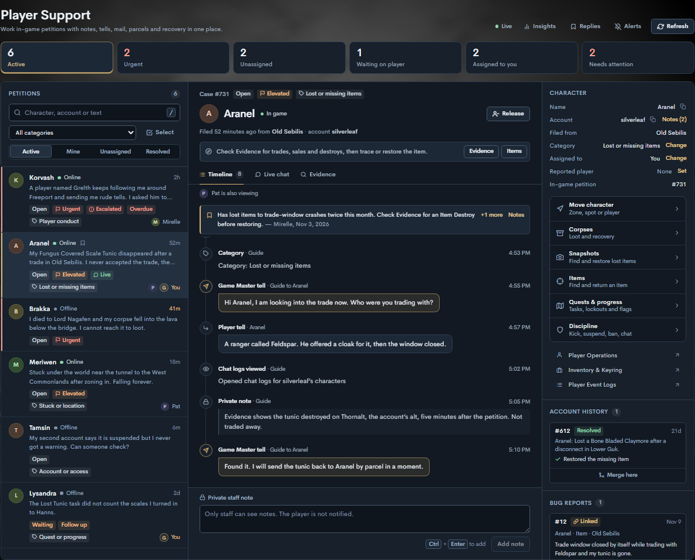

# Player Support live chat

The petition inbox uses the local EQEmu World roster for account presence. **Online** includes another character on the petition’s account and a player at character select. **Unknown** means Spire could not verify presence for the selected server. Messaging is per account: Spire sends tells to whichever character on the petition’s account is in a zone with tells on, and the case header shows **On <character>** when that is not the character that filed the petition.

## Without the companion patch

Player Support works on a stock EQEmu World. Spire checks the local World for the patch and turns off what needs it, with a note at the top of the page:

| Works on stock EQEmu | Needs the patch |
|---|---|
| The queue, case workflow and notes, mail and parcel delivery, corpse inspection, and presence | Live chat and in-game replies, character and corpse moves, move and parcel notices in game, and the `#petition` command and menu |

- **Live chat** shows the conversation history. A message to a player with no character in game is still mailed, but it doesn't turn on **Messages**, because the player can't reply in game. When the player is in game, Live chat says tells need the patch and points to **Reply by mail**.
- **Move character** is unavailable, and the recovery window explains why. Corpses can still be inspected.
- A World with an older revision of the patch keeps moves and notices, and turns off Live chat until World and zones are rebuilt with the current patch.

Spire rechecks World about every 30 seconds while the patch is missing, so the tools come back on their own after World restarts with it.

## Enable live tells

1. Apply [the EQEmu companion patch](player-support-eqemu.patch) in your EQEmu server checkout with `git apply player-support-eqemu.patch`. The patch applies cleanly, and World and zone build with it, on both of these:
   - [Valorith/Server `master` at dc15939](https://github.com/Valorith/Server/commit/dc1593967a7e929dfa6a503de341f6d1ab60028d)
   - [EQEmu/EQEmu `master` at 4aceae18](https://github.com/EQEmu/EQEmu/commit/4aceae18b94ffaafc08e2b17bc41cd72c77f795d)

   It only calls APIs that both trees share. For example, it starts transactions with a plain `START TRANSACTION` query because `TransactionBegin()` returns a result in Valorith/Server but `void` upstream.
2. Build and install the patched World and zone binaries on your test installation. Keep the World console reachable from Spire on IPv4 loopback. Spire reads its port from `server.world.telnet` in `eqemu_config.json`.
3. Open **Server Admin → Player Support** and select a petition. Send a tell from **Live chat** to turn on **Messages** automatically. Use **Enable messages** if you want the player to write first. In EverQuest, the player can answer with `#petition <message>`, `/reply <message>` after a Game Master tell, or `/tell *GameMaster <message>`.

Turning **Messages** on or off is recorded on the case timeline with the staff member's name. When you resolve a case you can add an optional resolution summary, which is shown on the timeline next to the status change.

Spire grants chat actions through Player Support write access. The patch reserves `GameMaster` and `*GameMaster` as tell destinations. A reply is recorded and acknowledged when it comes from any character on the petitioning account, the in-game petition is active, and **Messages** is on for that case. Every tell, in either direction, lands in the same conversation, labelled with the character that sent or received it and marked **alt** when that is not the character that filed the petition. Players receive a private reason if they have no active petition or **Messages** is off. Turning off **Messages** or resolving the case preserves the transcript.

When no character on the petition's account is in game, a message sent from **Live chat** is mailed to the character that filed the petition instead, from GameMaster with the subject "Response to your petition". The mail reads "This message was sent to you in response to your petition while you were offline: " followed by the message. It is kept in the same conversation, marked **Sent by mail** with a mail icon. A player who is in game with tells turned off is not mailed; Live chat explains that tells are off.

Spire and the patched World use console protocol version 2 to confirm replies. If you installed an earlier revision of the patch, rebuild World and zone with the current patch before updating Spire. World holds up to three unconfirmed replies per character; a player who sends more before Spire confirms them is asked to try again.

The patched World also refreshes the parcel window and shows the native arrival notice for online recipients when Spire sends a parcel to the local server. Parcels are committed before World is notified. Players can collect queued parcels from a parcel merchant when they next open the window.

Test an account with its petitioning character offline and an alternate online. The queue should show **Online**, the case header **On <alternate>**, and tells should reach the alternate and appear in the same conversation. Also test that reconnecting World restores messaging on an enabled petition and that switching to an unrelated database connection shows **Unknown** for presence.

## Filing petitions with #petition

The patch adds a `#petition` command for players. It works alongside `/guidehelp`, which is how current clients open the petition window. Petitions are one per account, and any character on the account can use the command.

- `#petition` with no message shows the petition menu: each open petition on the account with its number, the character that filed it, how long ago, its status, whether **Messages** is on, and a preview of the request. Saylinks refresh the menu, explain how to add a message, and withdraw the petition after a confirmation.
- `#petition <message>` files a petition when the account has none. It creates the same petition as `/guidehelp`, so it appears in Player Support right away.
- While the account has an open petition, `#petition <message>` adds to it. The text goes to Game Master like a tell. Spire records it on the case when **Messages** is on, and otherwise tells the player why it could not.

The menu's status comes from Spire when Spire tracks the case: waiting for a Game Master, assigned to a staff member, waiting for the player's reply, or resolved. Spire stores it in the `spire:petition:<petition>` data bucket whenever the case or its messaging changes. Without it, the menu shows the in-game queue state. A petition checked out in game shows who is reviewing it.

The menu's links use `#petition reply` and `#petition withdraw <number> [confirm]`; those exact phrases are actions, not messages. Server operators can rename or restrict the command in the `command_settings` table like any other command.

## Character and corpse recovery

Open **Move character** or **Corpses** from a petition. Player Operations read access lets staff inspect locations and loot. A move requires write access to both Player Support and Player Operations, an open or waiting case, and a reason recorded in the petition timeline.

Recovery uses the same companion patch and loopback World console. Online characters and loaded corpses also require the source zone's TCP WebSocket listener to be reachable on IPv4 loopback from Spire. Corpses go to a base zone's safe point or to the player. Buried corpses can be inspected. Moves are available for unburied corpses.

A character can be moved to a base zone's safe point, to exact coordinates in a base zone, or to another character's location. Choose **Coordinates** to enter X, Y, Z and a heading (0–511). You can paste the output of `/loc`, which lists Y, X, Z, and Spire puts the values in the right fields. Choose **Player** to search for any character. Spire uses that character's live position when they are in game and their last saved position otherwise. Moves into instances are not supported, so a character inside an instance cannot be used as the destination.

A cross-zone character receipt confirms that the zone requested the move. If a receipt is unconfirmed, refresh the target's location before trying again.

For an unburied corpse, choose **Player’s current location** to use the petitioning character’s live coordinates and instance. The character must be in game. The destination zone sends a chat notice when it confirms the corpse arrived.

Spire character moves send **You have been moved by a Game Master**. If Spire relocates a saved character, the patched zone displays the notice when the player next enters the game.
