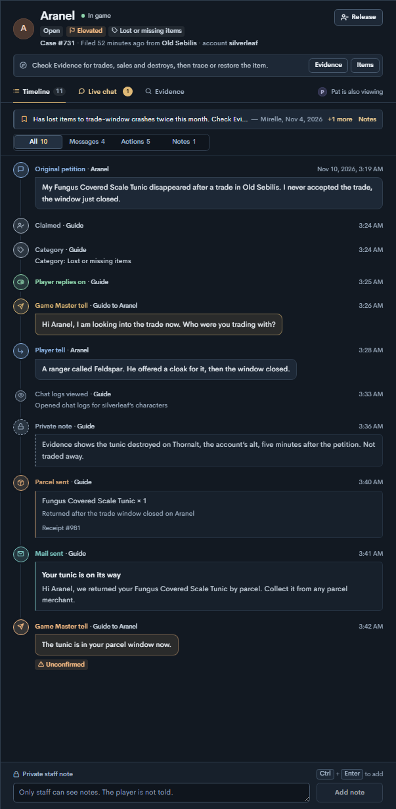
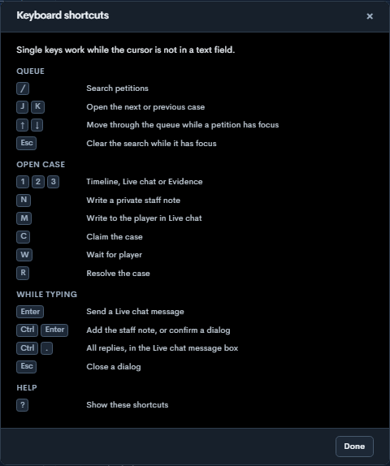

# Player Support

Player Support is the petition inbox under **Server Admin → Player Support**. Staff work each petition as a case: notes, tells, mail and parcels, character and corpse recovery, and the GM tools described below. Every action is recorded on the case timeline with the staff member's name.

The inbox uses the local EQEmu World roster for account presence. **Online** includes another character on the petition's account and a player at character select. **Unknown** means Spire could not verify presence for the selected server. Messaging is per account: Spire sends tells to whichever character on the petition's account is in a zone with tells on, and the case header shows **On <character>** when that is not the character that filed the petition.

On a phone or a narrow window, the queue and the open case show one at a time: the queue summary is compact, an open case keeps a bar at the top whose **Petitions** button goes back to the queue where you left it, and **Live chat** fills the screen with the message box at the bottom. On a tablet in landscape the queue stays beside the case. Every dialog fits the screen with its buttons in view, and on a phone it does not open the on-screen keyboard by itself. Notices float at the bottom of the window instead of pushing the page down.

Some tools need the companion EQEmu patch, and some need its updated revision. Everything else works on stock EQEmu. [What each server gets](#what-each-server-gets) lists them.

## Without the companion patch

Player Support works on a stock EQEmu World. Spire checks the local World for the patch and turns off what needs it, with a note at the top of the page:

| Works on stock EQEmu | Needs the patch |
|---|---|
| The queue, case workflow and notes, mail and parcel delivery, corpse inspection, presence, and every tool marked "stock" in [What each server gets](#what-each-server-gets) | Live chat and in-game replies, character and corpse moves, move and parcel notices in game, and the `#petition` command and menu |

- **Live chat** shows the conversation history. A message to a player with no character in game is still mailed. **Player replies** cannot be turned on, because the player can't reply in game. When the player is in game, Live chat says tells need the patch and points to **Reply by mail**.
- **Move character** is unavailable, and the recovery window explains why. Corpses can still be inspected.
- A World with an older revision of the patch keeps moves and notices, and turns off Live chat until World and zones are rebuilt with the current patch.

Spire rechecks World about every 30 seconds while the patch is missing, so the tools come back on their own after World restarts with it.

## Enable live tells

1. Apply [the EQEmu companion patch](player-support-eqemu.patch) in your EQEmu server checkout with `git apply player-support-eqemu.patch`. The patch applies cleanly, and World and zone build with it, on both of these:
   - [Valorith/Server `master` at dc15939](https://github.com/Valorith/Server/commit/dc1593967a7e929dfa6a503de341f6d1ab60028d)
   - [EQEmu/EQEmu `master` at 4aceae18](https://github.com/EQEmu/EQEmu/commit/4aceae18b94ffaafc08e2b17bc41cd72c77f795d)

   It only calls APIs that both trees share. For example, it starts transactions with a plain `START TRANSACTION` query because `TransactionBegin()` returns a result in Valorith/Server but `void` upstream.
2. Build and install the patched World and zone binaries on your test installation. Keep the World console reachable from Spire on IPv4 loopback. Spire reads its port from `server.world.telnet` in `eqemu_config.json`.
3. Open **Server Admin → Player Support** and select a petition. Send a tell from **Live chat**, and use **Turn on replies** when you want the player's answers on the case. In EverQuest, the player can answer with `#petition <message>`, `/reply <message>` after a Game Master tell, or `/tell *GameMaster <message>`.

**Player replies** decides only whether the player's answers are accepted onto the case. Live chat shows it at the end of its first line, with **Turn on replies** or **Turn off replies** beside it; hovering it says what it does. It never limits what staff send: with write access, the message box works on any open case whatever the setting, as a tell when the player is in game and by mail when nobody on the account is. Sending does not turn replies on or off. **Turn on replies** works while the player is offline too; it needs the current patch on the server Spire runs beside, and an older patch never turns replies on. While replies are off, a line under the message box says so ("the player can read this but cannot answer"), and if the player answers, the game tells them "Your message was not sent. Replies to the Game Master are not open on your petition right now; a Game Master will open them when they need your answer." Nothing is recorded on the case.

With the updated patch, a message World delivers as a tell is also shown to that character as a yellow on-screen marquee, "Game Master: <message>", for 6 to 15 seconds depending on its length. The marquee is cut to 120 characters and ends in "..."; the tell always has the full message, and Live chat says so while a draft is longer than the marquee. Mail, account action notices and replies World turns away get no marquee. Live chat mentions the marquee only when World reports the `marquee` feature.

**Persona.** Each staff member can choose the name players see on their tells from Spire. **Change name** next to the message box shows "Players see you as (GM) <name>" and lets you set the name, or **Use default** to go back to "Game Master". A persona is 3 to 24 characters, letters and single spaces only, starting with a letter. Names that read as the default (such as "GameMaster" or "game master") are refused. Spire keeps one persona per Spire user, and one for a local install with authentication off. In game, the tell shows "(GM) <name>" and the marquee "<name>: <message>". Live chat shows "as (GM) <name>" on tells sent under a persona; the timeline keeps the staff member's real name. Mail is not affected and still comes from `GameMaster`. A persona can match a character's name: Spire warns, but allows it, because World gives Player Support only the replies to that name from players it has messaged under it. World remembers that for 24 hours and forgets it when World restarts.

Personas need the updated patch: World lists `persona` in `supportfeatures`, and Spire then sends tells as `supportchat send <request_id> <account_id> <character_id> <message_hex> [<persona_hex>]`, with the persona as lowercase hex of its letters. Spire adds the persona only when World lists `persona` and the persona is set and is not "Game Master"; otherwise it sends the five arguments as before, because an older World does not answer a sixth. World checks the name again and falls back to "Game Master". Without the feature, **Change name** is off and says why. The replies-closed tell sent when you turn replies off uses your persona too; tells with no staff member behind them use none.

**Player AFK.** When a tell from Spire reaches a player who is AFK, the client answers by itself at once ("Sorry, I am A.F.K. (Away From Keyboard) right now."). Spire treats a reply as that automatic answer when it follows a tell Spire sent to the same character and either it is that text (or starts with "Sorry, I am A.F.K.") within 30 seconds of the tell, or it comes within 2 seconds of the tell, whatever it says, since a custom `/afk` message can say anything. The answer is not recorded as a player message and raises no new-reply marker or alert. Instead, each tell it answers (every tell to that character inside the window not forwarded yet) is mailed to the character, one mail each, from `GameMaster` with the subject "Message about your petition" and the text "The following message was sent to you by a Game Master regarding your open petition, but you were AFK: " followed by the tell. The new-mail alert fires as for other Spire mail. A tell is forwarded once. In Live chat the tell gets an amber edge and one badge, "AFK · sent by mail" with the time; its tooltip, also read by screen readers, says "<character> was AFK; this message was also sent by in-game mail". While the mail is being written it reads "AFK · mailing…". If the mail cannot be written, the badge reads "AFK · mail failed" in red, and its tooltip says to send the message again or use **Reply by mail**. The timeline gets one **Forwarded by mail, player AFK** entry. **Player replies** does not change.

Turning **Player replies** on or off is recorded on the case timeline with the staff member's name.

When **Player replies** goes from on to off, by **Turn off replies** or by resolving the case, the player is told so. A character on the account that is in game gets a tell from the Game Master, and the character that filed the petition always gets a mail from the Game Master with the subject "Replies to your petition are closed". While the petition is still open in game, the notice says that a Game Master will contact them if more is needed, and that once the petition is closed they can file a new one with `#petition`; petitions are one per account, so a new one can't be filed until then. When the petition is closed, it says to file a new petition with `#petition` for more help. The notice never names the staff member. The **Turned off player replies** entry on the timeline says how it went (told in game, mailed, or could not be mailed), and so does the answer in Live chat or the Resolve notice. Neither a failed tell nor a failed mail turns replies back on. The mail is recorded in the audit log and on the timeline like **Reply by mail**, so, like an account action notice, it counts as an answer. Turning replies off again when they are already off, or retrying the request, sends nothing. A resolve that sends a saved reply first doesn't send the notice, because the saved reply already tells the player.

When you resolve a case you can add an optional resolution summary, which is shown on the timeline next to the status change.

Spire grants chat actions through Player Support write access. The patch reserves `GameMaster` and `*GameMaster` as tell destinations. A reply is recorded and acknowledged when it comes from any character on the petitioning account, the in-game petition is active, and **Player replies** is on for that case. Every tell, in either direction, lands in the same conversation, labelled with the character that sent or received it and marked **alt** when that is not the character that filed the petition. Players receive a private reason if they have no active petition or **Player replies** is off. Turning off **Player replies** or resolving the case preserves the transcript.

When no character on the petition's account is in game, a message sent from **Live chat** is mailed to the character that filed the petition instead, from the Game Master with the subject "Response to your petition". The mail reads "This message was sent to you in response to your petition while you were offline: " followed by the message. It is kept in the same conversation, marked **Sent by mail** with a mail icon, and the line under the message box quotes that opening sentence before anything is sent. A player who is in game with tells turned off is not mailed; Live chat explains that tells are off.

### Mail to the Game Master

Every mail Spire writes for a case comes from the Game Master. **Reply by mail**, a Live chat message mailed to an offline player, and the notices all have the sender `GameMaster`, the Game Master's in-game name, so a player who presses Reply in the mail window writes to `GameMaster`. Players can't reply to any other sender, such as "Server Support". A parcel sent from a case shows "Game Master" as its sender; a parcel can't be answered.

With the patched UCS (World reports `mail_replies`), a player can answer a Game Master mail, or write a new mail to `GameMaster`, from the in-game mail window. UCS keeps the mail for Spire instead of delivering it. The Spire web server (`http:serve`, not Spire's game server launcher) collects it every 30 seconds, whether or not anyone has Player Support open, from the game server database it is configured with (the one Live chat uses):

- When the sender's account has an open petition whose case has **Player replies** on, the mail joins that case's conversation from the character that sent it (marked **alt** like a tell), with its subject. It flags the case with a new reply like a tell does. Any character on the account can write. In Live chat it shows as a mail card ("Mail from" the character, and the subject) with **Read message**, which opens the whole mail in a dialog; on the timeline it shows its first lines and the same button. A Game Master's **Reply by mail** on the case (including a saved reply sent while resolving) also shows in Live chat, as a card "Sent by mail to" the character, in order with the player's tells and mail, as soon as it is sent. Its text is read from the player's mailbox, so a reply the player has deleted shows only its subject and time. It is never counted as a new player message. On the timeline it stays one **Mail sent** entry. Short Live chat messages mailed to an offline player stay ordinary messages.
- Otherwise Spire mails the sender an automatic answer from the Game Master with the subject "Your message was not delivered". It quotes nothing from their mail. Without an open petition, it says the Game Master mailbox is only read while they have an open petition and to file one with `#petition`. With an open petition and **Player replies** off, it says replies are not open on the petition right now and a Game Master will open them when they need an answer. Each sender gets at most one automatic answer every 10 minutes; more undeliverable mail in that time is dropped. Automatic answers are recorded in the audit log.
- Mail from a name that is not a character is dropped.

Where staff send mail (**Reply by mail**, a Live chat message mailed to an offline player, and the account action notice), Spire mentions that the player can answer it while **Player replies** is on, but only when World reports `mail_replies`. A long mail is shortened to 4,000 characters on the case. At most three mails per sender are taken in one collection; UCS also refuses a sixth uncollected mail from one character. Each mail is handled by the Spire that removes it first.

**More than one Spire on one game database.** A live Spire and a development or staging Spire can point at the same game database while each keeps its own Spire database, and each collects mail to `GameMaster`. Each one decides before it takes a mail. Only the Spire whose database holds the account's conversation for the open petition files the mail, or answers that replies are not open. Any other Spire checks the petition's shared status, the `spire:petition:<petition>` data bucket that the Spire holding the case publishes whenever the case, its owner or **Player replies** changes (the same value the `#petition` menu reads). While that status says replies are on, it leaves the mail alone for the owning Spire and looks again every 5 minutes. A mail nobody takes within 24 hours is answered as undelivered, so the player gets an answer and their waiting mail cannot pile up. Either Spire can answer a sender who has no open petition. If the database fails while Spire handles a mail, the mail is never answered: it goes back for the next collection, and after three failures it is given up and logged.

### New-mail alerts

With the updated patch (World reports `mail_notice`), a character in a zone who gets mail from Spire also sees a yellow chat line and a marquee: "You have received a new mail message from a Game Master." The mail keeps its sender `GameMaster`; only the alert words it this way. This covers every mail Spire writes on the server it runs beside: **Reply by mail**, a Live chat message mailed to an offline player, the account action notice, the replies-closed notice, the automatic answer to mail sent to GameMaster, and mail sent from the Mail & Parcels editor (a direct send, a server-wide broadcast, or an unread mail record added by hand; parcels alone do not alert). The alert is sent after the mail is saved, in the background, and never changes the result of the send or adds anything to the timeline. A character that is zoning gets one more try a moment later. A character that is not in a zone is shown nothing. When the replies-closed tell already reached the player, the mail that goes with it does not alert, so two marquees do not overlap.

Two alerts come from the server patch itself, on every server that runs it, with or without Spire: on login, a player is told "You have N unread mail message(s).", and UCS alerts a player in game to mail from another player.

Spire and the patched World use console protocol version 2 to confirm replies. If you installed an earlier revision of the patch, rebuild World and zone with the current patch before updating Spire. World holds up to three unconfirmed replies per character; a player who sends more before Spire confirms them is asked to try again.

The patched World also refreshes the parcel window and shows the native arrival notice for online recipients when Spire sends a parcel to the local server. Parcels are committed before World is notified. Players can collect queued parcels from a parcel merchant when they next open the window.

Test an account with its petitioning character offline and an alternate online. The queue should show **Online**, the case header **On <alternate>**, and tells should reach the alternate and appear in the same conversation. Also test that reconnecting World restores replies on a petition with **Player replies** on and that switching to an unrelated database connection shows **Unknown** for presence.

## Filing petitions with #petition

The patch adds a `#petition` command for players. Petitions are one per account, and any character on the account can use the command.

- `#petition` with no message shows the petition menu: each open petition on the account with its number, the character that filed it, how long ago, its status, a **Replies** line from Spire's **Player replies** setting ("On - reply with #petition [message] or answer a Game Master mail" or "Off - a Game Master will open them when they need your answer"), and a preview of the request. Saylinks refresh the menu, explain how to add a message, and withdraw the petition after a confirmation.
- `#petition <message>` files a petition when the account has none. It creates the same petition as the client's own petition window, so it appears in Player Support right away.
- While the account has an open petition, `#petition <message>` adds to it. The text goes to the Game Master like a tell. Spire records it on the case when **Player replies** is on, and otherwise tells the player why it could not.

The menu's status comes from Spire when Spire tracks the case: waiting for a Game Master, assigned to a staff member, waiting for the player's reply, or resolved. Spire stores it in the `spire:petition:<petition>` data bucket whenever the case or its **Player replies** setting changes. Without it, the menu shows the in-game queue state. A petition checked out in game shows who is reviewing it.

The menu's links use `#petition reply` and `#petition withdraw <number> [confirm]`; those exact phrases are actions, not messages. Server operators can rename or restrict the command in the `command_settings` table like any other command.

## Character and corpse recovery

Open **Move character** or **Corpses** from a petition. Player Operations read access lets staff inspect locations and loot. A move requires write access to both Player Support and Player Operations, an open or waiting case, and a reason recorded in the petition timeline.

Recovery uses the same companion patch and loopback World console. Online characters and loaded corpses also require the source zone's TCP WebSocket listener to be reachable on IPv4 loopback from Spire. Corpses go to a base zone's safe point or to the player.

A character can be moved to a base zone's safe point, to exact coordinates in a base zone, or to another character's location. **Current zone** (its safe point) and **Bind point** are one-click destinations. Choose **Coordinates** to enter X, Y, Z and a heading (0–511). You can paste the output of `/loc`, which lists Y, X, Z, and Spire puts the values in the right fields. Choose **Player** to search for any character. Spire uses that character's live position when they are in game and their last saved position otherwise. Moves into instances are not supported, so a character inside an instance cannot be used as the destination.

A cross-zone character receipt confirms that the zone requested the move. If a receipt is unconfirmed, refresh the target's location before trying again.

For a corpse, choose **Player's current location** to use the petitioning character's live coordinates and instance. The character must be in game. The destination zone sends a chat notice when it confirms the corpse arrived.

Buried corpses can always be inspected. With the updated patch, a buried corpse can also be moved: it shows **Buried · will be unburied**, and the move clears its buried flag and restarts the corpse's decay timer. A buried corpse that is not loaded in any zone (Shadowrest) is moved in the database. Without the updated patch, only unburied corpses can be moved, and the recovery window says why.

Spire character moves send **You have been moved by a Game Master**. If Spire relocates a saved character, the patched zone displays the notice when the player next enters the game.

### Restore experience from a corpse

The corpse details show the experience the corpse holds. **Restore experience** returns the corpse's full resurrection experience to the player once and marks the corpse resurrected, so a later resurrection returns nothing. It needs:

- the updated patch on the server Spire runs beside;
- the player in game;
- the corpse loaded in the player's current zone and instance. Use **Player's current location** to move it to them first;
- a corpse that has not been resurrected and still holds experience.

The button stays disabled with the reason until all of these hold. The player is told in game that a Game Master restored the experience. The zone saves the character right away; if that save fails, Spire reports the restore as unconfirmed, so check the player's experience before trying again.

## Case workflow

- **Take over and assign:** any staff member with Player Support write access can take over a case from its owner, or assign it to another staff member or to nobody. **Release** is still for the owner only. The staff list shows the users who can write Player Support cases on the connection.
- **Escalate:** an escalated case needs a reason, sorts to the top of the queue, and shows an **Escalated** chip. Resolving a case clears the escalation.
- **Categories:** a case can have one of eight categories: lost or missing items, corpse or death, stuck or location, quest or progress, player conduct, bug report, account or access, and other. Spire suggests one from words in the petition, and staff apply it. Each category shows a short hint with buttons for the matching tools.
- **Reported player:** a case can name another character as the reported player, so Evidence can show that character's events. The character must exist and must not be on the petitioning account.
- **Needs attention:** an open case nobody has answered is **aging** after 30 minutes (its time turns amber and gets a clock) and **Overdue** after 2 hours (its time turns red and the case gets an **Overdue** chip). Hovering a case's age says when it was filed and which of these it is. A case marked waiting needs a **Follow up** when the player has not replied within 48 hours. A tell or a sent mail or parcel, including an account action notice, counts as an answer. The **Needs attention** card counts escalated, overdue and follow-up cases once each, and filters the queue to them. **Alerts** can also chime when a follow-up comes due.
- **Account notes:** staff can keep up to 20 notes of up to 2,000 characters per account on a connection. The newest shows above every case from that account. Adding or removing a note is recorded on the case where it was done.
- **Viewers:** the queue and the case header show who else has the case open and who is writing to the player. Before a tell or mail is sent while another staff member is writing, or within two minutes after one sent a message, Spire asks for confirmation. Nothing is locked.
- **Resolve and clear the petition:** **Also clear petition #N in game** is on by default. A petition checked out in game is not cleared and the option is off; clear it in game with `#delpetition`, or resolve without it. The case stays resolved whatever the result, and the result is recorded on the case:

  | Server | What happens |
  |---|---|
  | Updated patch | World removes the petition and every zone refreshes its list. The player can file a new petition right away. |
  | Patch without `supportfeatures`, no patch, or a server Spire does not run beside | Spire deletes the petition from the database. A zone that already loaded it keeps it until the next petition is filed or withdrawn, so the player may be told one is still open until then. With the earlier patch, `#petition` already sees the change. |

- **Reply and resolve:** a saved reply can be marked **Reply and resolve** in **Replies**. The Resolve dialog can send any saved reply first: as a tell when the player is in game and the reply fits in a tell, and by in-game mail otherwise, whatever **Player replies** says. The dialog shows the reply as the player will read it and says how it will go. The case is resolved only after the reply was sent; if the send fails, including a tell that World refuses, the dialog stays open with the error and the next try is a new send. If delivery was not confirmed, the dialog says so and does not send the reply again on its own: check the conversation, then choose **Send again and resolve** or **Resolve without sending again**.

### At a glance

- **Summary cards:** **Active**, **Urgent**, **Unassigned**, **Waiting on player**, **Assigned to you** and **Needs attention** count the live queue, and each one filters it. Choosing the card already chosen goes back to **Active**. **Urgent** counts cases filed as urgent (urgency 2 and above).
- **Queue:** the queue remembers its filter, category and search in this browser. While they leave cases out, a line under the filters says how many are showing ("Showing 2 of 6 active petitions") with **Clear filters**. Active cases are sorted escalated first, then urgent, then oldest; resolved cases newest first, as the label beside the count says. A case shows a status chip only when it is not simply open (**Waiting**, **Resolved**), along with **Urgent** or **Elevated**, **Escalated**, **Overdue**, **Follow up**, **Replies on** and its category. A screen reader reads each case as a short line: character, status, urgency, age, a new reply and who has it.
- **After an action:** when you resolve a case or mark it waiting for the player, from the case or with a batch, the next case in the queue that needs staff opens, and the notice names it. The notice offers **Reopen** after a resolve and **Undo** after a wait, which reopens the case and opens it again. When no other case needs staff, the case stays on screen.
- **Notices:** a notice appears over the bottom of the queue, or at the bottom of the window when the queue is not beside the case, so nothing on the page moves. A success leaves after about 6 seconds (10 with **Reopen** or **Undo**), and stays while the pointer or keyboard focus is on it; a warning or an error stays until dismissed.
- **Navigation badge:** the **Player Support** button in the Server Admin navigation shows how many petitions are pending GM action. That is every live case (open in game or not yet resolved) except a case marked waiting for the player, unless the player has answered since it was marked waiting. The count refreshes about once a minute while the tab is visible, and at once while the queue is open. It is hidden at 0, shows 99+ above 99, and is only shown to staff who can see Player Support.
- **Live chat tab:** while the open case has a player message you have not seen in Live chat, the tab shows how many and pulses. It stops once Live chat is open and the message is on screen. With reduced motion, the count shows without pulsing. The browser tab title counts the cases in the queue with a player reply you have not seen, for example "(2) [Spire] Player Support". A new reply that came by mail shows a mail icon on its **New** chip in the queue.
- **Timeline:** each entry sits on a rail with an icon and a colour for its kind: player messages, Game Master messages, mail, parcels, case workflow, account actions, recovery, tools, notes, and quiet system entries such as viewed chat logs. A failed action is red and a delivery that needs checking is amber. Entries with more than one line show a title and its detail. Messages from the same side within five minutes read as one exchange. Hovering a time in the queue, the timeline, Live chat, account history or bug reports shows the full date and how long ago it was; in Evidence, where times count from the petition, it shows the date. **All**, **Messages**, **Actions** and **Notes** filter the timeline; the original petition always stays.
- **Live chat:** when new messages arrive while you are reading earlier ones, **New messages** jumps to them. A message counts as seen only once it is on screen. Follow-up messages from the same sender within five minutes sit under one header, and a separator marks each day.
- **Message box:** the line above it says how the message will go (a tell to the character in game, plus the on-screen marquee when World supports it, or mail to the mailbox) and shows **Player can answer** while **Player replies** is on. **Enter** sends. A tell is one line of plain text, so line breaks become spaces, and curly quotes, dashes and ellipses pasted from elsewhere become plain ones; a character a tell cannot carry is named before anything is sent. A counter appears near the 200-character limit, and a draft longer than the marquee shows what the marquee will carry. The unsent draft is kept per case in this browser tab, across tabs and cases, and stays in the box when a send fails, with **Retry** (the same request, so it cannot arrive twice) and **Send by mail instead**, which opens **Reply by mail** with the text. A failed message in the conversation offers **Retry** and **Edit**; one whose delivery was not confirmed offers only **Edit**. When a tell cannot go (tells turned off, no patch), the message box is replaced by the reason and **Send by mail instead**.
- **Replies in Live chat:** a row of quick replies sits above the message box, and **Replies** (or **Ctrl+.** in the message box) opens every saved and built-in reply with a search; arrow keys and **Enter** insert one, **Esc** goes back to the box. A saved reply too long for a tell is listed but marked for **Reply by mail**.
- **Reply by mail:** a missing subject or message is pointed out under its field when you choose **Review reply**. Closing the dialog keeps the draft for that case in this browser tab, and it comes back the next time; it is cleared once the mail is sent. **Send parcel** says what is still missing beside **Review**, and that the reason is kept in the audit log while the parcel note is what the player reads.
- **Copy:** the character name, the account, an item's ID in **Items**, a corpse's ID in **Corpses** and a bug report's number each have a copy button that says **Copied**.
- **Keyboard:** press **?** (or **Keyboard shortcuts** under the queue) for the list. Single keys work while the cursor is not in a text field or a dialog; Spire's own shortcuts all use **Ctrl**, so they never clash.

  | Key | Does |
  |---|---|
  | `/` | Search petitions (**Esc** in the search clears it) |
  | **J**, **K** | Open the next or previous case in the queue |
  | **1**, **2**, **3** | **Timeline**, **Live chat** or **Evidence** |
  | **N** | Write a private staff note |
  | **M** | Open **Live chat** with the cursor in the message box |
  | **C** | Claim the case, when nobody has it |
  | **W** | Wait for player, on an open case |
  | **R** | Resolve the case |
  | **?** | Show the shortcuts |

  A key that does not apply to the open case (for example **C** on a case someone has) does nothing. The case views and the tabs in the tool dialogs are tab lists: the arrow keys, **Home** and **End** move between them, and the arrow keys move through the queue while a case has focus. A dialog keeps focus inside it and gives it back to the button that opened it. **Ctrl+Enter** adds the staff note, and in a dialog it confirms: the reason or summary field confirms the tool, the Resolve dialog resolves, **Reply by mail** reviews and then sends, and **Replies** saves the reply being written. While a dialog is open, **Ctrl+Enter** belongs to the dialog only. Keys pressed while a dialog opens or closes are ignored too, so a key never acts on the page behind it.

### Select mode

**Select** above the queue adds a checkbox to each case. With cases selected, a bar offers **Claim**, **Assign…**, **Category…**, **Wait** and **Resolve…** for up to 50 cases at once. **Assign…** and **Category…** list the choices as rows, like the single-case **Assign** dialog, with a search when the staff list is long. Each case is updated on its own, with the same rules as the single-case action, so one case that changed or is checked out in game does not stop the others. The notice says how many were updated and lists each case that was not, with the reason. A batch resolve can clear the cases' petitions in game, on by default.

## Investigation and repair tools

All of these are in the case's side panel or tabs. Tools that change a player's data ask for a reason (8 to 240 characters), which is recorded on the case timeline and in the audit log, and refuse to run on a resolved case.

The tool dialogs work the same way:

- **Reason:** the reason field shows a counter. The confirm button stays available; choosing it with a missing or short reason points that out under the field and sends nothing. **Ctrl+Enter** in the reason confirms.
- **Changes that take something away** (kick, suspend, ban, revoking chat, removing a task or lockout, resetting a step, clearing a record or timer) say what is lost before they run and confirm with a red button. Focus starts on the safe choice, and **Back** returns to the list.
- **Read only:** when a tool cannot change anything, its footer says why: the case is resolved, the petition is checked out in game, or a permission is missing. A control that needs the updated server patch, or the player in game or offline, says so under it.
- **Results** say what happened and that it is on the case timeline. A change World did not confirm is shown as unconfirmed and is never sent again from the dialog; check in game first.
- A tool that fails to load says why, with **Try again**. **Esc** closes a dialog and returns focus to the button that opened it.

- **Evidence:** the case's **Evidence** tab lists player events from every character on the petition's account, from 6 hours to 7 days before the petition up to now, with a marker where the petition was filed. Filter by items, deaths, zoning, GM commands, tasks, chat (Say and Player Speech) or possible hacks. When the case has a reported player, Evidence can switch to that character's events. It needs Player Event Logs read access, and only shows event types turned on in the Player Event Log settings. **Chat** needs its own permission and says when Say or Player Speech logging is off. Without that permission, chat is also left out of **All**.
- **Inventory snapshots:** **Snapshots** compares an inventory snapshot with the character's current inventory and bank, and lists what is missing. Items found elsewhere on the account (a corpse, a parcel, the shared bank, another character) or already returned by staff since the snapshot are set aside under **Accounted for** and cannot be selected. Selected items open in the parcel composer with a reason filled in, for review before sending. **Where is it?** opens the item in **Items**. EQEmu takes snapshots when the `Character:ActiveInvSnapshots` rule is on, or with `#invsnapshot capture`.
- **Account history:** the side panel lists the account's other cases with their resolution summaries. **Merge here** moves an earlier case's notes, messages and deliveries into the open case and resolves the earlier one with a link. A case whose petition is still open in game can't be merged away.
- **Saved replies:** **Replies** in the header manages replies shared by everyone on the server connection. Use `{character}` for the player's name and `{account}` for the account. Replies that fit in a tell (200 plain characters) also show as Live chat quick replies; all of them show as mail templates, and a built-in template with the same name as a saved reply is left out. With more than three replies the list has a search. Deleting a reply asks for confirmation in its row.
- **Alerts:** **Alerts** turns on desktop notifications and a chime for new petitions, player replies and follow-ups due, in this browser. It can also post each new petition to a Discord channel, using a webhook from EQEmu's `discord_webhooks` table. Spire checks every 30 seconds, announces only petitions filed after the channel is chosen, and turns mentions off. A burst of petitions becomes one message that lists up to five and counts the rest. A failed post, whether Discord rejects it or the network fails, is not retried, so keep an eye on the queue as well. Discord alerts come from the Spire running beside the game server.
- **Insights:** **Insights** shows petitions filed in the last 7, 30 or 90 days, including ones nobody has opened yet. **Resolved** and **Merged** are those petitions' current status, not everything resolved during the period. It also shows the median time to first response and to resolution, and responses and resolutions per staff member. Work dated before a case was filed, such as history merged in from an earlier case, is not counted.

### Items

**Items** traces one item across the account: the character's inventory and bank, the account's other characters, the shared bank, corpses, parcels waiting to be collected, items staff already returned (from Player Support or Mail & Parcels), and item events from the last 30 days (at most 20). Open it from the side panel and choose an item, from **Trace** on an Evidence row (destroyed, sold, dropped, or given away in a trade), or from **Where is it?** in Snapshots.

**Return by parcel** opens the reviewed parcel composer with the item and a reason filled in; nothing is sent until staff review and confirm it there. When the item is still somewhere on the account, or was returned before, Spire says where and asks first. An item that stacks keeps its count. An item that does not stack is returned as one item per copy: one from an Evidence row, and one per missing copy from a snapshot. The parcel composer does not carry charges, so a charged item arrives as a new item rather than with the charges it had.

**Restore history** lists every parcel batch staff sent to the account's characters in the last 90 days.

### Quests & progress

**Quests & progress** has three tabs. A line at the top says whether changes go to the database (the character is offline) or apply in game.

- **Tasks** lists active tasks with their steps, completed tasks and task timers. A step can be reset or advanced, and a task removed. In game this needs the updated patch. Offline, a step can be advanced to one short of its goal but never completed, because the reward is only granted in a zone; the dialog says to complete it while the player is in game. When an in-game change completes the task, the confirmation shows the reward first. If the zone cannot save an in-game change, Spire says the game server did not confirm it. Completed records and timers can be cleared while the character is offline. Shared tasks are read-only: the shared task system owns them, so use `#task` in game.
- **Lockouts** lists unexpired expedition lockouts, instances and the safe return point. A lockout can be removed: in the database while the character is offline, and in game with the updated patch. Instances are read-only; the player can leave an expedition with `/dzquit`.
- **Flags** lists zone flags, keys, data buckets and quest globals, with links to the Inventory & Keyring, Data Buckets and QGlobals editors. **Reload game cache** makes zones read data buckets from the database again after an edit. It uses World's stock `api reload 7` command, on the server Spire runs beside only.

A database change needs Spire to see the character offline. A character between zones is asked to try again in a moment. When the character is marked in game and Spire cannot check the World roster (World is down, or runs on another host), changes stay off until that clears. The panel says which of the two it is.

### Account Action

**Account Action** kicks the account's character from the game, suspends or bans the account, lifts a restriction, and revokes or restores chat. It shows the account's status, the restriction reason, whether chat is revoked, and who is playing now.

- **Kick** disconnects the account's character that is in a zone, with World's stock console `kick` command. It works without the patch, but only on the server Spire runs beside. A player at character select is not affected.
- **Suspend** sets the account status to -1 until the chosen time. **Ban** sets it to -2 with no end date. Both ask for a second confirmation, block login in EQEmu, and kick the account's characters in game when Spire runs beside the server. **Lift restriction** clears the reason and date and sets the status back to 0.
- Spire suspends and bans player accounts only (status 0 to -2). An account with a staff status is refused with the reason, and lifting a restriction never changes a staff status. This also keeps EQEmu's suspension expiry, which resets the status to 0 when the date passes, from removing a staff status.
- An account restricted by an older Spire, which saved the reason and date without changing the status, is flagged: EQEmu never enforced it. Apply the restriction again to enforce it.
- **Revoke chat** sets the account's revoked flag, and **Restore chat** clears it. What the flag blocks depends on the server build:
  - With the updated patch, OOC, auction and shout are always blocked, and tells still work. The dialog says exactly this.
  - On stock EQEmu and the earlier patch, it blocks tells, blocks OOC and auction only when those channels are server-wide, and never blocks shout. The dialog says only that the channels depend on the server build.
  - On every build, custom (UCS) chat channels read the flag when the player connects to chat, so a change reaches them at the player's next login.

  While no character on the account is in game it is saved to the database and applies at the next login. For a player in game it needs the updated patch on the server Spire runs beside and applies at once. Without the patch, kick the player first or wait until they log out; on any other server, wait until they log out.
- **Notice by mail:** after every action that succeeds (kick, suspend, ban, lift restriction, revoke or restore chat), Spire mails the character that filed the petition a fixed notice from the Game Master with the subject "Notice of account action". It greets the character, says what the Game Master team did (with the suspension's end in UTC), and asks the player to file a petition with `#petition` with any questions. It does not include the staff member's name or the reason, which stays an internal note on the case. A suspended or banned player reads it after they can log in again. The mail appears on the case timeline like **Reply by mail** and is recorded in the audit log. A refused or failed action sends nothing, and retrying the same request does not send a second notice. If the mail cannot be written, the action still stands, and the result says the notice could not be mailed. The notice is written to the database, so it works on stock EQEmu and on any server connection.

### Player Operations changes

Player Operations applies the same suspend, ban and lift rules. Suspending or banning now sets the account status, so World really blocks the login; before, Spire saved only the reason and date. It refuses staff accounts, and kicks the account's characters in game after a suspension or ban when the account is on the server Spire runs beside.

It also refuses profile edits, moves, currency changes, transfers and retirement while the character is in game, because the game would overwrite the change when it saves the character. Log the player out, or kick them from Player Support, first.

### Linked accounts and bug reports

- **Linked accounts** lists other accounts that have logged in from the same IP addresses as the petitioning account: their restriction, the shared addresses, up to five characters, and how many cases they have on this connection. Spire checks only when **Check shared IP addresses** is pressed. Up to 50 accounts are shown.
- **Bug reports** lists the account's `/bug` reports from the last 30 days, plus any linked to the case, up to 50. Staff can link a report to the case, unlink it, or mark it reviewed with an optional note (**Ctrl+Enter** in the note marks it). The section is hidden when the account has no reports.

## Privacy

- IP addresses never leave the server in full. IPv4 addresses keep their first three parts and end in `.x`; IPv6 addresses keep their first three groups and end in `:x`. Loopback addresses, and addresses shared by more than 25 accounts (usually a shared connection, such as a cafe), are left out, and the number left out is shown.
- Opening linked accounts, and viewing chat in Evidence (the **Chat** group, or chat events under **All**), adds an entry to the case timeline: "Checked linked accounts (N found)" or "Opened chat logs for …". Each is recorded at most once an hour per staff member.
- Account notes are visible to staff only, on every case from that account.

## Permissions

Player Support uses the **Player Support** resource: read to see the queue and cases, write for every change (claiming, notes, replies, workflow actions, select mode, account notes). Some tools also need another grant on the connection. Controls the viewer cannot use are hidden or disabled.

| Tool | Also needs |
|---|---|
| Move character, corpses, Snapshots, Items, Quests & progress | Player Operations (read to view, write to change) |
| Restore experience, remove a lockout, task changes | Player Operations write |
| Return by parcel, snapshot restores | Mail & Parcels Editor read and write |
| Account Action | Player Support write and Player Operations read to open; Player Operations write to act (the notice mail needs no Mail & Parcels grant) |
| Evidence | Player Event Logs read |
| Chat in Evidence | Player Event Logs read and **Player Support Chat Logs** read |
| Linked accounts | **Player Support Linked Accounts** read |
| Reload game cache | Data Buckets Editor write |
| Mark a bug report reviewed | Bug Reports write |

**Player Support Chat Logs** and **Player Support Linked Accounts** are separate from **Player Support**: a Player Support grant does not include them. Give them on the user's permission screen for the connection (**Admin → Users**), where they appear with a Read checkbox. Connection owners and users with an **ALL** grant have them.

## What each server gets

Spire asks World which Player Support features its patch supports with the `supportfeatures` console command, about once a minute together with the patch check. The updated patch (patch 3) reports ten: `close_petition`, `lockouts`, `tasks`, `revoke`, `corpse_exp`, `unbury`, `marquee`, `mail_replies`, `mail_notice` and `persona`. A build that does not list `marquee`, `mail_replies`, `mail_notice` or `persona` keeps the others: its tells show no marquee, Spire does not mention mail answers, mail from Spire arrives without an in-game alert, and tells show the default name. `mail_replies` also needs UCS built from the patch. A tool that needs a missing feature stays visible and disabled with the reason: "Needs the updated Player Support patch" on the server Spire runs beside, or "Needs the game server this Spire runs beside" for any other connection.

| Tool | No patch | Patch without `supportfeatures` | Updated patch | Server Spire does not run beside |
|---|---|---|---|---|
| Queue, workflow, notes, mail, parcels, Evidence, Snapshots, Items, flags, linked accounts, bug reports, account notes, select mode | Yes (stock) | Yes | Yes | Yes |
| Live chat, moves, in-game notices, `#petition` | No | Yes | Yes | No |
| Clear the petition in game when resolving | Database delete | Database delete | World command, zones refresh | Database delete |
| Remove a lockout | Offline only | Offline only | Offline and in game | Offline only |
| Task fixes | Offline only | Offline only | Offline and in game | Offline only |
| Kick | Yes (stock) | Yes | Yes | No |
| Suspend and ban | Yes, with kick | Yes, with kick | Yes, with kick | Yes, without kick |
| Revoke chat | Offline only | Offline only | Offline and in game | Offline only |
| Fixed revoke policy (OOC, auction and shout blocked, tells allowed) | No | No | Yes | Not detected; the dialog uses the general line |
| On-screen marquee for Game Master tells | No | No | Yes | No |
| Mail to `GameMaster` joins the case | No | No | Yes, with the patched UCS | No |
| Persona on tells ("(GM) <name>") | No | No | Yes | No |
| In-game alert for mail Spire sends | No | No | Yes | No |
| Replies-closed notice | Mail only (stock) | Tell and mail | Tell and mail | Mail only |
| Account action notice by mail | Yes (stock) | Yes | Yes | Yes |
| Restore experience | No | No | Yes | No |
| Move a buried corpse | No | No | Yes | No |
| Reload game cache | Yes (stock) | Yes | Yes | No |

With the patch revision that has no `supportfeatures` command, live chat and moves keep working, because the chat protocol is unchanged. The page shows no extra banner; the tools in the table that need the updated patch are disabled with their reason.

## Upgrading the server

1. Update Spire first. It works with the older patch and with none.
2. Start from your EQEmu checkout without the earlier Player Support patch: a clean checkout of the same base, or the earlier patch reversed with `git apply -R` and the old patch file. Then apply the current [companion patch](player-support-eqemu.patch) with `git apply player-support-eqemu.patch`. Do not edit the patch file.
3. Rebuild World, zone and UCS, install them, and restart World, UCS and every zone. Mail to `GameMaster` needs the rebuilt UCS.
4. Within about a minute, Spire detects the new features. Open a case and check that the Resolve dialog says "The player can file a new petition right away."

## Known limits

- Shared tasks are read-only.
- An offline task edit never completes a step. Complete it while the player is in game.
- Restoring corpse experience needs the player in game, in the corpse's zone and instance.
- If a resurrection is already on its way to the player when the experience is restored, the player can receive the experience twice. Check that nobody is resurrecting the player first.
- The aging (30 minutes), overdue (2 hours) and follow-up (48 hours) times are fixed.
- Viewer presence is kept by each Spire process. Two Spire instances behind one database do not see each other's viewers.
- Instances and expeditions are read-only; Spire does not change expedition membership.
- Snapshots count an item staff returned since the snapshot as accounted for, even if the player lost it again later. Return it again in the parcel composer by hand if needed.
- Evidence chat shows the selected character's own events only; it does not match tells between the petitioner and the reported player.
